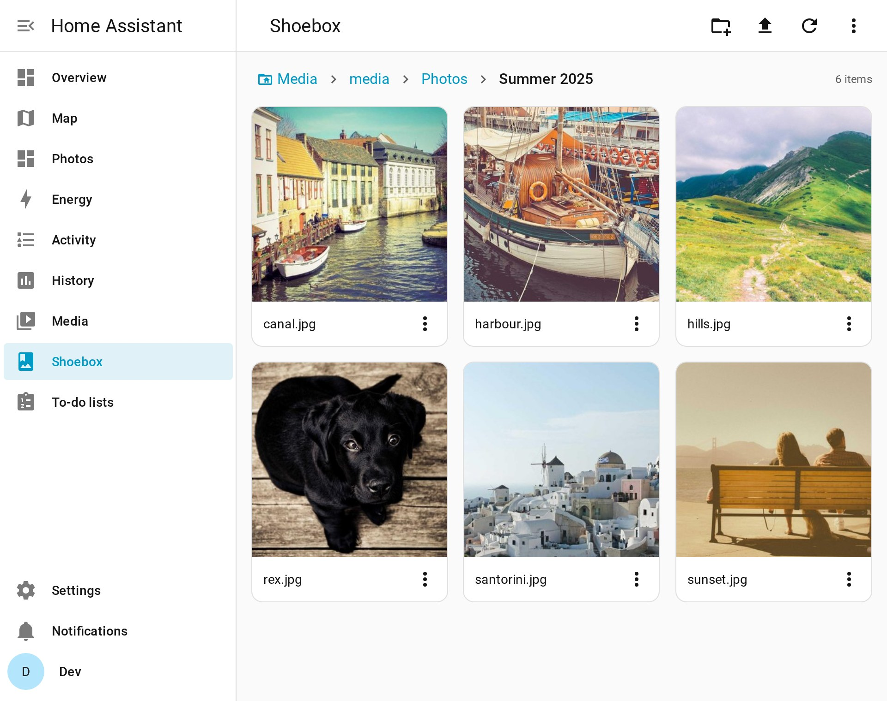
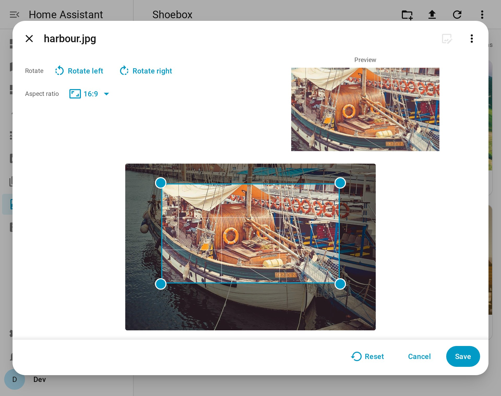

# Shoebox

Shoebox: media manager and picture organizer for Home Assistant. Organize, upload, rotate and crop the photos in your media folder, and show them as rotating pictures on dashboards, notifications and displays.

  
  

Home Assistant's media browser can upload and delete files. Shoebox adds what it doesn't have: folders, moving and renaming, uploads that never overwrite, thumbnails, and rotate and crop that keep the picture's quality. On top of that, a *rotation* turns a set of pictures into an image that changes, for dashboards, phones and small displays.

## What you can do

- **Organize the photos in My media from your phone**: create folders, rename, move and delete. [How](docs/use-cases.md#organize-from-your-phone)
- **Upload from your phone straight into the right folder.** An existing file is never overwritten. [How](docs/use-cases.md#upload-from-your-phone)
- **Fix sideways photos and crop them** without re-encoding: the turn and the crop are stored in the photo's own metadata. [How](docs/use-cases.md#fix-sideways-photos-and-crop)
- **Run a slideshow on a dashboard**, on a tablet, TV or browser. [How](docs/use-cases.md#slideshow-on-a-dashboard)
- **Build a digital photo frame** with an ESPHome e-ink or LCD display. [How](docs/use-cases.md#esphome-photo-frame)
- **Show different pictures by time of day or season**, switched by automations. [How](docs/use-cases.md#pictures-by-time-of-day-or-season)
- **Send a photo of the day** in a notification. [How](docs/use-cases.md#photo-of-the-day)
- **Put the kids' artwork on the wall**, uploaded from the phone. [How](docs/use-cases.md#kids-artwork-wall)

## Install

1. In HACS, search for **Shoebox** (or "media manager", "photo") and download it. Restart Home Assistant.

   Until Shoebox is in HACS's default list, add it first: **HACS → ⋮ → Custom repositories**, repository `https://github.com/MarZab/ha-shoebox`, type **Integration**.
2. Go to **Settings → Devices & services → Add integration** and add **Shoebox Media Manager**. Choose the media folders it works on; **My media** (`local`) is chosen already.
3. Open **Shoebox** in the sidebar.

Shoebox works on the media folders you choose: My media, and any added with `media_dirs` in `configuration.yaml`. Removing the integration leaves your files as they are. More in [configuration](docs/configuration.md).

## Get started

The [quick start](docs/quick-start.md) adds a rotation and puts it on a dashboard, with screenshots, and connects an ESPHome display. The [actions and entities](docs/README.md#actions-and-entities) are listed in the documentation.

## Limits

- Rotate and crop work on JPEG files. Other formats (PNG, HEIC, ...) are shown and served, but not edited.
- Shoebox works on the media folders chosen at setup. A large network share makes rotations slower, since each step lists its pictures.
- The panel is for administrators.
- It is made for a household media folder: hundreds of pictures, not a photo library.

## Documentation

[docs/](docs/README.md) has the details: rotations and patterns, every action, the entities, editing, displays, the panel, the cache and troubleshooting.

---

Keywords: media manager, picture organizer, photo organizer, photo frame, slideshow, file manager, Home Assistant.
