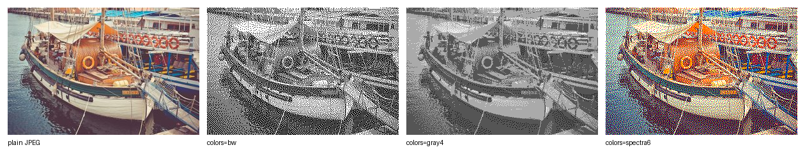

# Displays

Every rotation can be shown on dashboards, in notifications, in the media browser and on devices outside Home Assistant.

## Dashboards

Use the rotation's [image entity](entities.md#image) with a picture entity card:

```yaml
type: picture-entity
entity: image.living_room
show_name: false
show_state: false
```

A picture glance card works the same way and can add the Next button:

```yaml
type: picture-glance
title: Living room
entity: image.living_room
entities:
  - entity: button.living_room_next
```

The card fetches the new picture whenever the rotation moves on or its picture is edited.

## Notifications

The Home Assistant Companion app can attach the current picture:

```yaml
action: notify.mobile_app_my_phone
data:
  message: Photo of the day
  data:
    image: /api/image_proxy/image.photo_of_the_day
```

## Media browser

Each rotation appears under **Media → Shoebox** as a folder of the pictures it selects. Pictures from there can be played on media players that show images, such as a Chromecast. They are served prepared (turned and cropped) at up to 1920 × 1080.

## Devices

Each rotation has a URL that always serves its current picture, prepared at the size the device asks for:

```text
http://<home assistant>:8123/api/shoebox/image/image.living_room?width=800&height=480&fit=cover
```

| Parameter | Default | |
|-----------|---------|---|
| `width`, `height` | 1280 | The size in pixels, 1 to 4096 |
| `fit` | `contain` | `cover`: exactly this size, the overhang cut evenly. `contain`: fitted inside, aspect kept |
| `colors` | none | A palette for e-paper and other limited displays: `bw`, `gray4`, `gray16`, `spectra6` (black, white, red, yellow, blue, green), `acep7` (adds orange), or your own 2 to 256 hex colours, such as `000000,ffffff,c03030` |
| `dither` | `floyd` | With `colors`: `floyd` (Floyd–Steinberg error diffusion) or `none` (nearest colour) |
| `format` | `jpeg`, or `png` with `colors` | `jpeg`, `png` or `bmp` (24 bit). Dithered pictures need `png` or `bmp`: JPEG smears the dots |
| `contrast`, `saturation`, `brightness` | `1` | 0 to 3; applied before the palette. E-paper often looks better with more contrast and saturation |

- The picture is a baseline JPEG, which small displays can decode, unless `colors` or `format` asks for something else.
- The URL stays the same while the rotation moves on, across reloads and restarts.
- Each response has an `ETag`. A device that sends it back in `If-None-Match` gets `304 Not Modified` while the picture is unchanged.
- Before the rotation's first Next, the URL answers `404`.

The URL needs one of two keys:

- **The image entity's own token**, for devices that talk to Home Assistant, such as ESPHome. Every image entity carries a short-lived access token in its `entity_picture` attribute (`/api/image_proxy/image.living_room?token=…`), which Home Assistant changes every 5 minutes; Shoebox's URL accepts it as `?token=…`, as Home Assistant's own image proxy does. The device reads the attribute over its Home Assistant connection, so it needs no user, no long-lived token and no secret. A token opens only its own rotation. See the [ESPHome example](#esphome).
- **A long-lived access token** in an `Authorization: Bearer …` header, for any other device: see [a user for devices](#a-user-for-devices).

A wrong or expired `token` gets `403`; a wrong `Authorization` header gets `401` and counts as a failed login, as everywhere in Home Assistant.

### A user for devices

For devices that cannot read Home Assistant's entities. The URL then needs an access token, sent as `Authorization: Bearer <token>`. A token carries all the rights of its user, so give devices their own user:

1. **Settings → People → Users → Add user**: name it *Displays*, and leave **Administrator** off.
2. Log in as that user once, open its profile, **Security → Long-lived access tokens → Create token**.
3. Put the token on the device. Delete the token in the same place to lock the device out.

### ESPHome

[ESPHome](https://esphome.io/)'s [online image](https://esphome.io/components/image/online_image/) downloads the picture and a display draws it. This photo frame reads the rotation's image entity over the ESPHome API: its token from `entity_picture`, and its state, which changes whenever the rotation moves on. It downloads the picture then, at its own size, with the token. No long-lived token, no secret and no automation in Home Assistant.

ESPHome configuration (`photo-frame.yaml`):

```yaml
esphome:
  name: photo-frame

api:

http_request:

logger:
  logs:  # at debug level these log the picture URL, which holds the token
    homeassistant: INFO
    text_sensor: INFO
    online_image: INFO
    http_request: INFO

globals:
  - id: token
    type: std::string

text_sensor:
  # the image entity's picture URL holds its access token, which changes every 5 minutes
  - platform: homeassistant
    id: picture
    entity_id: image.living_room
    attribute: entity_picture
    internal: true
    on_value:
      - lambda: |-
          auto at = x.find("token=");
          if (at == std::string::npos) return;
          bool first = id(token).empty();
          id(token) = x.substr(at + 6);
          if (first) id(show).execute();
  # the image entity's state changes when the rotation moves on
  - platform: homeassistant
    id: shown
    entity_id: image.living_room
    internal: true
    on_value:
      - script.execute: show

script:
  - id: show
    then:
      - if:
          condition:
            lambda: return !id(token).empty();
          then:
            - online_image.set_url:
                id: photo
                url: !lambda |-
                  return "http://homeassistant.local:8123/api/shoebox/image/image.living_room"
                         "?width=800&height=480&fit=cover&token=" + id(token);
            - component.update: photo

online_image:
  - id: photo
    url: http://homeassistant.local:8123/api/shoebox/image/image.living_room  # set before each download
    format: JPEG
    type: RGB565
    update_interval: never
    on_download_finished:
      - component.update: frame

display:
  - platform: ...  # your display
    id: frame
    update_interval: never
    lambda: |-
      it.image(0, 0, id(photo));
```

- Add the device to Home Assistant as usual (Settings → Devices & services → ESPHome); Home Assistant then sends it the entity's state and attributes.
- The `logger` lines keep the token out of the device's log: at debug level, ESPHome logs the attribute and the URL.
- Match `width` and `height` to the display. For e-paper, use `fit: cover` and the image `type` your display supports, such as `BINARY` or `GRAYSCALE`.

#### With a long-lived token

A device without the ESPHome API, or one that should not depend on it, uses a [long-lived token](#a-user-for-devices) in a header and lets Home Assistant tell it when to download:

```yaml
online_image:
  - id: photo
    url: http://homeassistant.local:8123/api/shoebox/image/image.living_room?width=800&height=480&fit=cover
    format: JPEG
    type: RGB565
    update_interval: never
    request_headers:
      Authorization: !secret shoebox_authorization  # "Bearer <long-lived token of the Displays user>"
    on_download_finished:
      - component.update: frame

api:
  actions:
    - action: show_next_photo
      then:
        - component.update: photo
```

```yaml
alias: Photo frame follows the living room
triggers:
  - trigger: state
    entity_id: image.living_room
actions:
  - action: esphome.photo_frame_show_next_photo
```

### E-paper and other limited displays

E-paper panels show a few colours, and a photo needs dithering to look right on them. Shoebox does it before the device downloads the picture, so the device only draws pixels:



For a black and white panel, ask for `colors=bw` and let ESPHome read it as a 1-bit image:

```yaml
online_image:
  - id: photo
    url: http://homeassistant.local:8123/api/shoebox/image/image.living_room?width=800&height=480&fit=cover&colors=bw
    format: PNG
    type: BINARY
    update_interval: never
```

With the [ESPHome example](#esphome), add the same parameters to the URL in its `set_url`, and set `format` and `type` as here. For greyscale panels use `colors=gray4` or `gray16` with `type: GRAYSCALE`; for colour e-paper use `spectra6` or `acep7` with `type: RGB`.

The named palettes use pure colours. A real panel shows duller ones, so a photo can look grainy or off. To tune it:

- Raise `contrast` and `saturation` a little, such as `contrast=1.2&saturation=1.4`.
- Give the colours your panel really shows instead of a name: photograph or measure each of its colours and list them, such as `colors=1a1a1a,f0f0e6,b03a2e,e8c13a,2e4d8a,3a7d44`. Dithering then picks the colours as the panel shows them.
- Try `dither=none` for drawings and text, where dots look worse than flat colours.

Each combination of parameters is prepared once and cached, with its own `ETag`.

## URL lifetime

- The device URL itself does not change. With a long-lived token it works as long as the token does.
- The image entity's token changes every 5 minutes; Home Assistant accepts the current one and the one before, so a device that reads the attribute always has a working one.
- Home Assistant's `/api/image_proxy/<entity_id>` serves the same picture, but always at the entity's size; the device URL takes yours.
- Thumbnails and pictures in the [panel](panel.md) use signed links that work for one hour; the panel asks for new ones before that.
