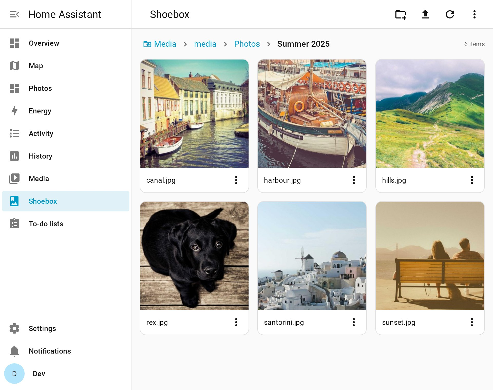
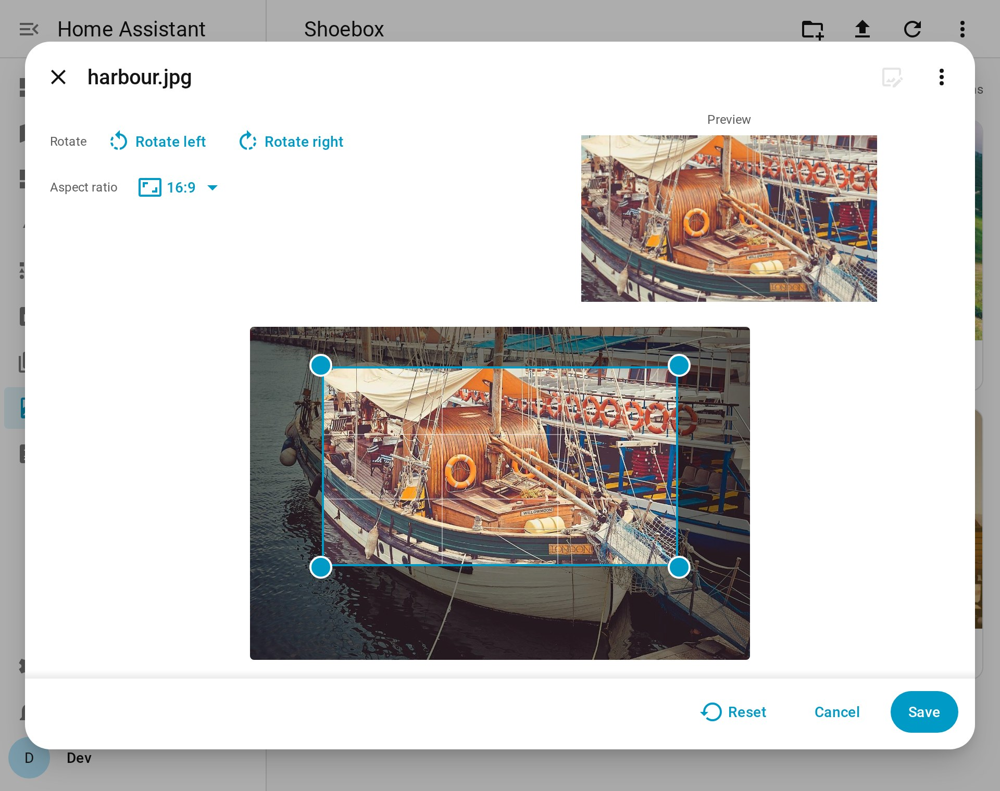
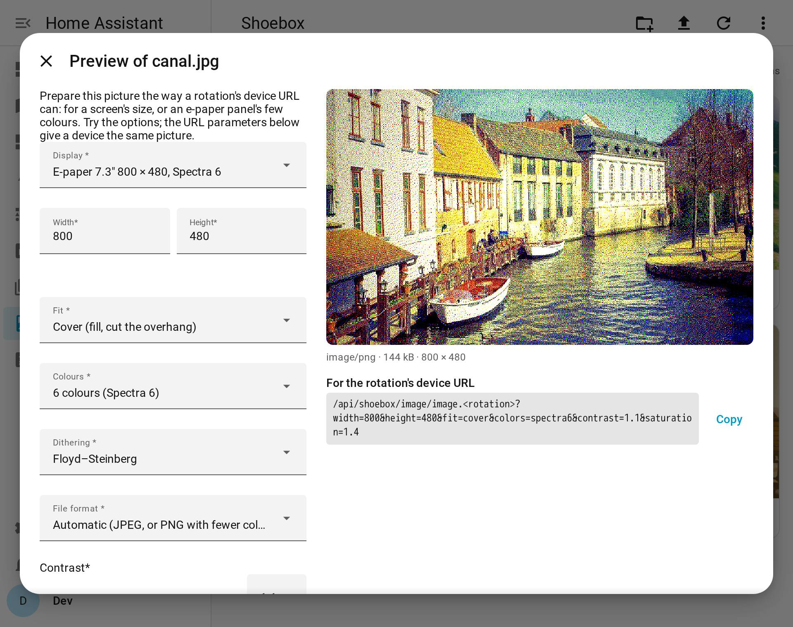

# Panel

The **Shoebox** panel in the sidebar manages the media folders. It is for administrators; others do not see it.

## Browsing

The panel opens at the media folders Shoebox uses, named as in Home Assistant's media browser: by their directory, such as `media` for My media. (Paths in actions and patterns use the folder's ID instead, such as `local/Family/beach.jpg`.) When Shoebox uses only one media folder, the panel opens that folder directly, as Home Assistant's media browser does, and **Media** at the top of the path stands for it. Inside them, folders come first, then files, each sorted by name; pictures show a thumbnail with their [edits](editing.md) applied. Click a folder to open it, and the path at the top to go back. Hidden files and symbolic links are not shown.

## Uploading

- **Upload** in the top bar picks files; or drag files from your computer anywhere onto the panel.
- Files go into the folder you are looking at; open a media folder first. Several files upload at once; a list shows each one's progress.
- Pictures, videos and audio can be uploaded, up to 200 MB each.
- An existing file is never overwritten: a second `photo.jpg` is stored as `photo-1.jpg`.

## Folders and files

- **New folder** in the top bar creates a folder in the current one, inside a media folder.
- Moving can go into another media folder, such as from My media to a network share.
- The menu (⋮) of a file or folder opens it (pictures, text files and folders), downloads it (files), renames it, moves it into another folder, or deletes it. Deleting asks first; a folder is deleted with everything in it, and **this cannot be undone**. Include the media folder in your Home Assistant backups to be able to restore files.

## Viewing and editing pictures

Click a picture to see it large; the arrows go to the previous and next picture in the folder.

For JPEG pictures, **Edit** in the top bar opens the editor:

- **Rotate left** and **Rotate right** turn the picture; a crop box turns with it.
- Draw a box, move it, or drag its corners. The preview next to the controls shows the result.
- **Aspect ratio** (a dropdown) keeps the box at *Free*, the picture's *Original* shape, or a fixed ratio such as 16:9, 4:3, 1:1 or 9:16.
- **Save** stores the turn and the crop together. **Cancel** leaves the picture as it was. **Reset** removes the crop; save to keep that.

## Views and search

The menu (⋮) in the top bar has the same choices as Home Assistant's media browser:

- **Auto**, **Grid** or **List**. The grid shows thumbnails; the list shows a small thumbnail, the name, size and date. *Auto* shows a grid where a folder has pictures and a list where it has none. The choice is remembered in this browser.
- **Search** shows a search field. Searching looks in the current folder and every folder below it, for files and folders whose name contains the text, ignoring case, as Home Assistant's media search does: hidden names are skipped, and the first 100 results are shown. At the top level it searches every media folder. Each result shows where it is, and opens, downloads, renames, moves and deletes like any other item. Clearing the field, or going to another folder, shows the folder again.

## Preview a picture for a display

**Preview** (the screen icon next to **Edit** in the picture viewer, or in a picture tile's menu ⋮) prepares it the way a rotation's [device URL](displays.md#devices) can, with a knob for every option: a preset for common screens and e-paper panels, width and height, fit, colours (full colour, black and white, greys, 6 or 7 colour e-paper, or your own), dithering, file format, contrast, saturation and brightness. The preview shows the picture as the device would get it, with its file type and size, and below it the parameters to add to the rotation's device URL, ready to copy. Trying options does not fill the cache.

## Keyboard

- **Tab** reaches folders, files, the path at the top and every button; **Enter** or **Space** opens what has focus.
- In a picture, the left and right arrow keys go to the previous and next picture.
- In the editor, focus the picture: the arrow keys move the crop, **Shift** with the arrow keys makes it larger or smaller. **Escape** goes back to the picture without saving.

## Text files and downloads

- Click a text file (notes, logs, `.csv`, `.json`, `.yaml`, subtitles, ...) to read it. Markdown files are shown formatted. Files are shown read-only; to edit them, use an editor such as the File editor app.
- Files over 256 KB show their first 256 KB, with a note.
- A file that is not text says so instead of showing garbage.
- Text that is not UTF-8, such as older subtitle files, is read in the code page of your language (Central European for Slovenian, Western otherwise).
- **Download** in the menu (⋮) of a file, or in the picture viewer, saves the original file to your computer or phone.

## Rotations and settings

The menu (⋮) in the top bar opens **Rotations and settings**: the integration's page in Settings, where rotations are added, changed and deleted (see [rotations](rotations.md)) and the [options](configuration.md#options) live.

## Language

The panel follows your language in your profile: English and Slovenian, English otherwise.

## Hiding the panel

- For yourself: edit the sidebar (long-press its title) and hide **Shoebox**.
- For everyone: turn off **Show in sidebar** in the [options](configuration.md#options). Actions, entities and device pictures keep working.
