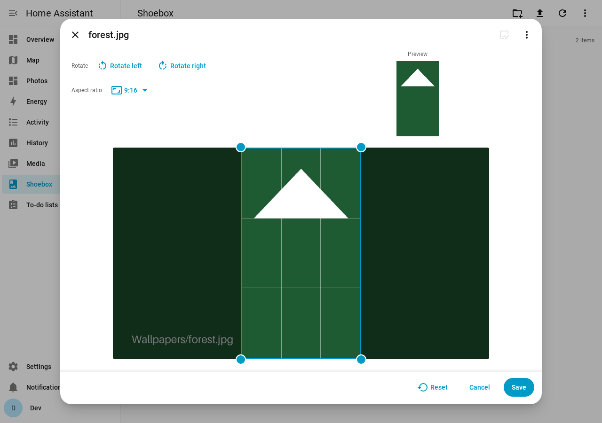
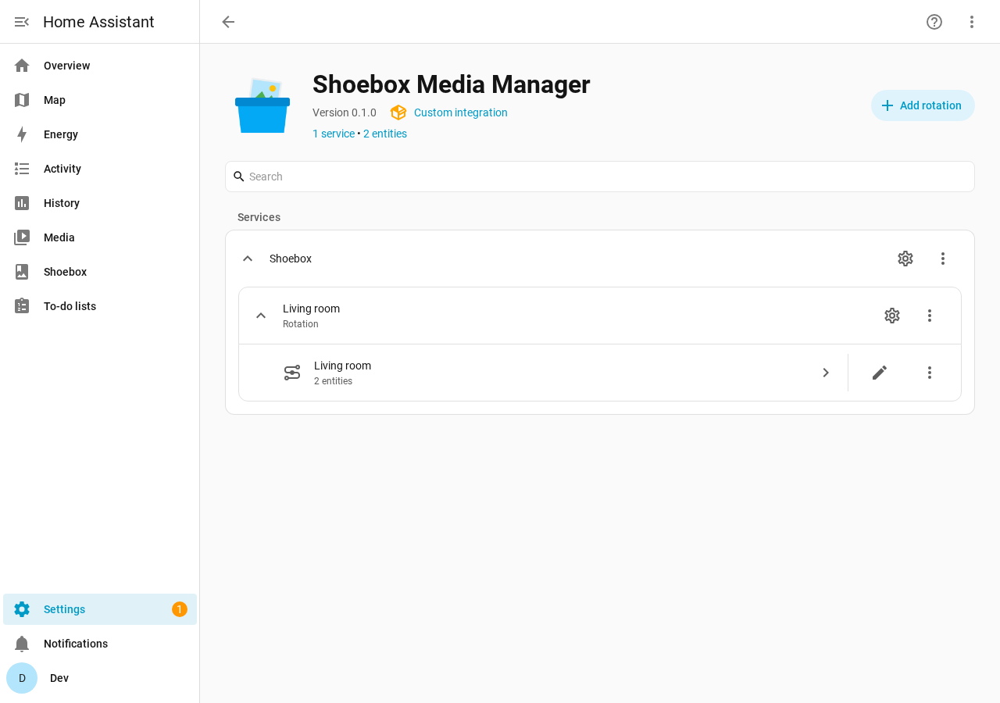

# Panel

The **Shoebox** panel in the sidebar manages the media folders. It is for administrators; others do not see it.

## Browsing

The panel opens at the media folders Shoebox uses, such as `local` (My media). Inside them, folders come first, then files, each sorted by name; pictures show a thumbnail with their [edits](editing.md) applied. Click a folder to open it, and the path at the top to go back. Hidden files and symbolic links are not shown.

## Uploading

- **Upload** in the top bar picks files; or drag files from your computer anywhere onto the panel.
- Files go into the folder you are looking at; open a media folder first. Several files upload at once; a list shows each one's progress.
- Pictures, videos and audio can be uploaded, up to 200 MB each.
- An existing file is never overwritten: a second `photo.jpg` is stored as `photo-1.jpg`.

## Folders and files

- **New folder** in the top bar creates a folder in the current one, inside a media folder.
- Moving can go into another media folder, such as from My media to a network share.
- The menu (⋮) of a file or folder opens it, renames it, moves it into another folder, or deletes it. Deleting asks first; a folder is deleted with everything in it, and **this cannot be undone**. Include the media folder in your Home Assistant backups to be able to restore files.

## Viewing and editing pictures

Click a picture to see it large; the arrows go to the previous and next picture in the folder.

For JPEG pictures, the top bar turns the picture left or right, and **Crop** opens the crop editor:

- Draw a box, move it, or drag its corners. The preview shows the result.
- **Aspect ratio** keeps the box at *Free*, the picture's *Original* shape, or a fixed ratio such as 16:9, 4:3, 1:1 or 9:16.
- **Save** stores the crop; **Reset** removes it.

## Rotations

The image button in the top bar switches to the rotations: each with its current picture, patterns, position and entity. **Next** moves a rotation on; the entity opens its details. **Manage rotations** goes to the integration's page in Settings, where rotations are added, changed and deleted (see [rotations](rotations.md)).

## Language

The panel follows your language in your profile: English and Slovenian, English otherwise.

## Hiding the panel

- For yourself: edit the sidebar (long-press its title) and hide **Shoebox**.
- For everyone: turn off **Show in sidebar** in the [options](configuration.md#options). Actions, entities and device pictures keep working.
