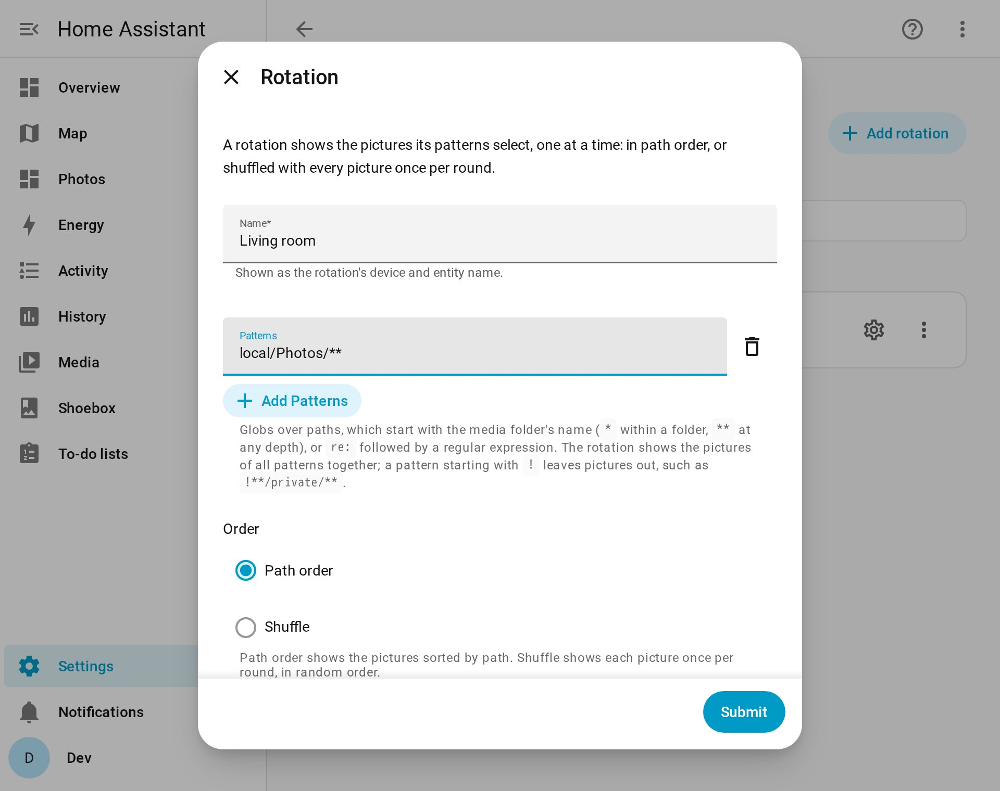
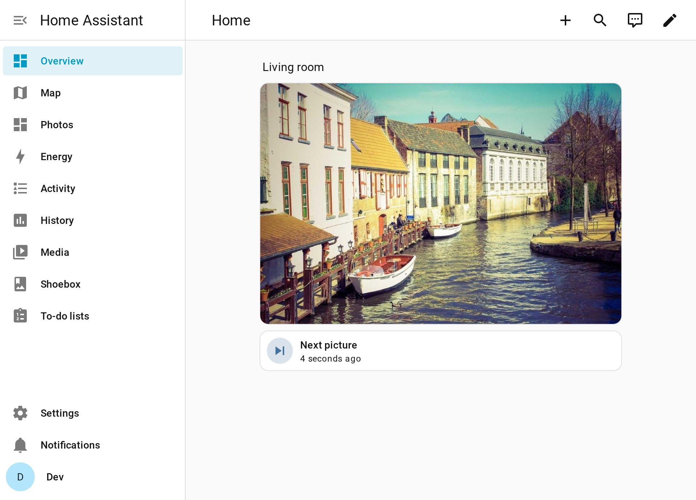

# Quick start

Shoebox is installed and added (see the [README](../README.md#install)). These two starts take a few minutes each.

## A rotation on a dashboard

A *rotation* is a set of pictures shown one at a time. It gets a device with an image entity, which shows the current picture, and a **Next** button.

### 1. Add a rotation

Go to **Settings → Devices & services → Shoebox Media Manager → Add rotation**.

- **Name**: *Living room*. It names the device and its entities: `image.living_room` and `button.living_room_next`.
- **Patterns**: tap **Add Patterns** and enter `local/Photos/**`, every picture below the `Photos` folder in My media. More patterns can be added; a pattern starting with `!` leaves pictures out. See [patterns](rotations.md#patterns).
- **Order**: *Path order* goes through the pictures by name; *Shuffle* shows each once per round, in random order.



**Submit** shows how many pictures the patterns select, and the first few. **Submit** again to add the rotation.

### 2. Put it on a dashboard

The rotation shows nothing until it moves to its first picture: press **Next** once, for example from the device page.

Then edit a dashboard and add a **Picture entity** card for `image.living_room`, and a **Tile** card for `button.living_room_next` to move on by hand. In YAML:

```yaml
type: picture-entity
entity: image.living_room
show_name: false
show_state: false
```

```yaml
type: tile
entity: button.living_room_next
name: Next picture
```



### 3. Move on by itself

An automation presses **Next** every 10 minutes:

```yaml
alias: Next living room picture
triggers:
  - trigger: time_pattern
    minutes: /10
actions:
  - action: button.press
    target:
      entity_id: button.living_room_next
```

Any trigger works: the time of day, someone coming home, a motion sensor. More in [use cases](use-cases.md).

## An ESPHome display

Every rotation has a fixed URL that serves its current picture at the size a device asks for, as a baseline JPEG small displays can decode. Create a [long-lived access token](displays.md#a-user-for-devices) for a user without admin rights, then:

```yaml
http_request:

online_image:
  - id: photo
    url: http://homeassistant.local:8123/api/shoebox/image/image.living_room?width=800&height=480&fit=cover
    format: JPEG
    type: RGB565
    update_interval: never
    request_headers:
      Authorization: !secret shoebox_authorization  # "Bearer <long-lived token>"
    on_download_finished:
      - component.update: frame  # the display's id

api:
  actions:
    - action: show_next_photo
      then:
        - component.update: photo
```

Draw it with `it.image(0, 0, id(photo));` and refresh it from Home Assistant whenever the rotation moves on:

```yaml
alias: Photo frame follows the living room
triggers:
  - trigger: state
    entity_id: image.living_room
actions:
  - action: esphome.photo_frame_show_next_photo
```

The whole setup is in [displays](displays.md#esphome).
